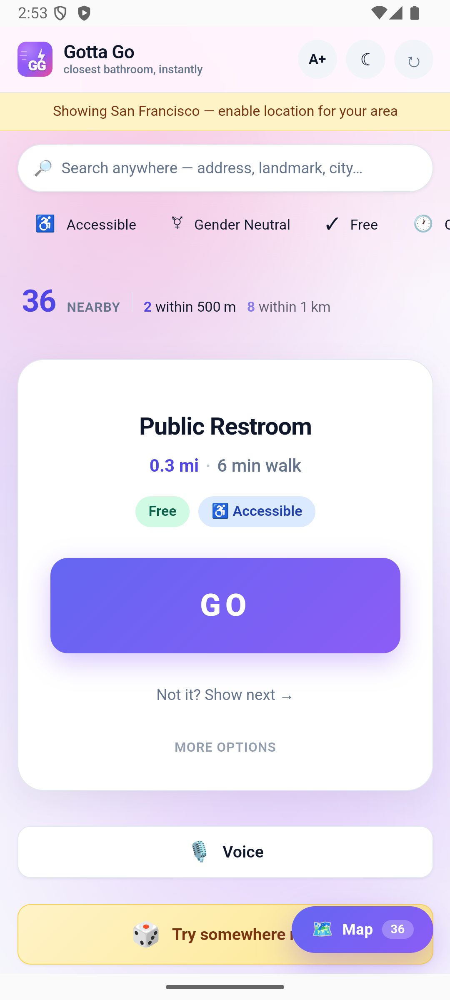
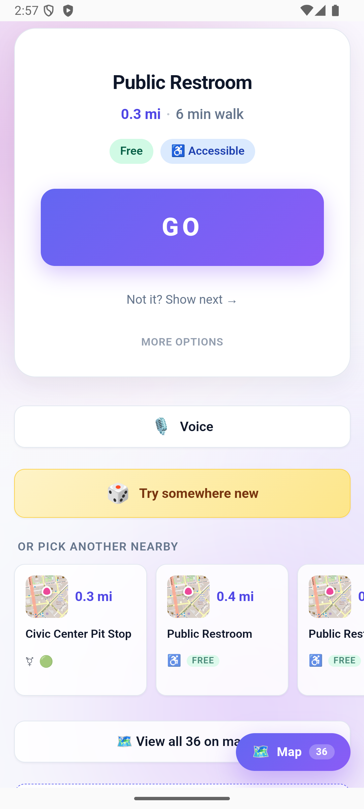

# Gotta Go (restroom-finder)

**A mobile-first web app that finds public restrooms near you, with accessibility and gender-neutral filters, community ratings and one-tap directions. Free, no account, installable as a PWA.**

🌐 **Live**: https://oscar-leung.github.io/restroom-finder/ · 📄 **About**: https://oscar-leung.github.io/restroom-finder/about.html

[](https://github.com/oscar-leung/restroom-finder/actions/workflows/deploy.yml)
[](LICENSE)

<p align="center">
  
  &nbsp;&nbsp;
  
</p>

## Why it exists

Needing a restroom in an unfamiliar place is a small, urgent problem that existing map apps handle badly: results are buried, accessibility is a guess, and half the pins are for customers only. Gotta Go asks one question, where is the nearest one I can actually use, and answers it from the crowdsourced [Refuge Restrooms](https://www.refugerestrooms.org/api/docs/) data on an [OpenStreetMap](https://www.openstreetmap.org) base.

## Features

- 📍 **Auto-detect location** via the browser's Geolocation API (with San Francisco fallback)
- 🗺️ **Interactive Leaflet map** with custom WC pins and a pulsing user dot
- 📋 **Sorted list** of nearby restrooms with distance (Haversine formula)
- ♿ **Accessibility filter** — toggle chips to show only accessible / gender-neutral options
- 👍 **Community ratings** — upvote/downvote counts from Refuge's crowdsourced data
- 🧭 **One-tap directions** — opens Google Maps for turn-by-turn navigation
- 📱 **PWA-ready** — installable on iOS and Android home screens, works with notched iPhone safe areas

## Stack

- [React 18](https://react.dev/) + [Vite](https://vitejs.dev/)
- [React-Leaflet](https://react-leaflet.js.org/) for the map
- Refuge Restrooms API (no API key required)
- Plain CSS (mobile-first, CSS custom properties, safe-area-inset support)

## Project structure

```
src/
├── hooks/
│   └── useGeolocation.js     # Browser GPS wrapper with refresh()
├── services/
│   └── restroomApi.js        # Refuge API client
├── utils/
│   └── distance.js           # Haversine formula + formatter
├── components/
│   ├── MapView.jsx           # Leaflet map + custom SVG pins
│   ├── FilterBar.jsx         # Horizontal chip row
│   ├── RestroomList.jsx      # Bottom sheet (mobile) / side drawer (desktop)
│   └── RestroomPanel.jsx     # Full details modal
├── App.jsx                   # Orchestrator
├── main.jsx                  # Entry point
└── index.css                 # All styles
```

## Development

```bash
npm install
npm run dev          # http://localhost:5173
npm run build        # production build → dist/
npm run preview      # preview the production build
```

## Deployment

The `dist/` folder is static — deploy to Vercel, Netlify, Cloudflare Pages, GitHub Pages, etc.

## Docs index

Planning, launch and marketing notes live beside the code. The doc index below says which to open.

| File | Read when you're… |
|---|---|
| **[LAUNCH_CHECKLIST.md](./LAUNCH_CHECKLIST.md)** | 👉 ready to ship to stores + monetize |
| [STATUS.md](./STATUS.md) | curious what's shipped vs in-flight |
| [ROADMAP.md](./ROADMAP.md) | planning the next features |
| [BUSINESS_MODEL.md](./BUSINESS_MODEL.md) | thinking about revenue |
| [HONEST_REALITY.md](./HONEST_REALITY.md) | wondering what Claude can / can't do |
| [THIS_WEEK_POSTS.md](./THIS_WEEK_POSTS.md) | posting to Reddit / IH / X today |
| [LAUNCH_POSTS_READY.md](./LAUNCH_POSTS_READY.md) | doing the bigger launch (PH, Show HN, etc.) |
| [SUBREDDIT_LIST.md](./SUBREDDIT_LIST.md) | hunting the next subreddit to post in |
| [BUILD_IN_PUBLIC.md](./BUILD_IN_PUBLIC.md) | writing the Friday "Week N: numbers" post |
| [MARKETING_PHASES.md](./MARKETING_PHASES.md) | thinking month-over-month, not week-over-week |
| [SEO.md](./SEO.md) / [COLLEGE_MARKETING.md](./COLLEGE_MARKETING.md) | targeting search / college students |
| [DATA_SOURCES.md](./DATA_SOURCES.md) | adding another bathroom data feed |
| [.claude/inbox/](./.claude/inbox/) | reading the daily / weekly agent reports |
| [.claude/agents/](./.claude/agents/) | invoking a specialized agent (marketing, seo, etc.) |

Powered by the free [Refuge Restrooms API](https://www.refugerestrooms.org/api/docs/) and [OpenStreetMap](https://www.openstreetmap.org).

## License

MIT, see [LICENSE](LICENSE). Restroom data is from Refuge Restrooms and OpenStreetMap under their own terms.
